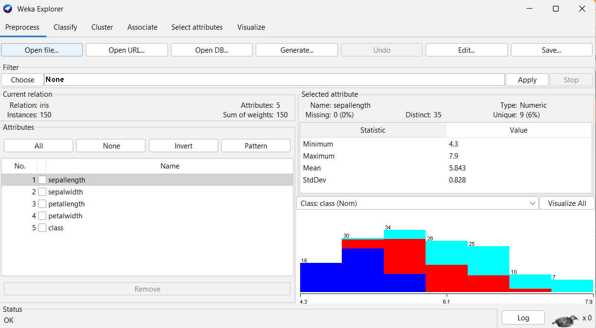
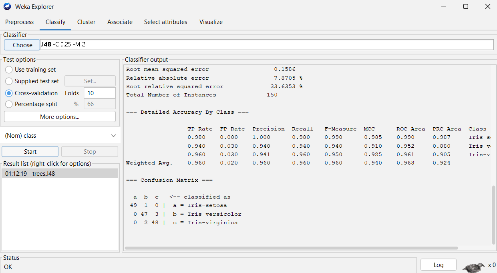
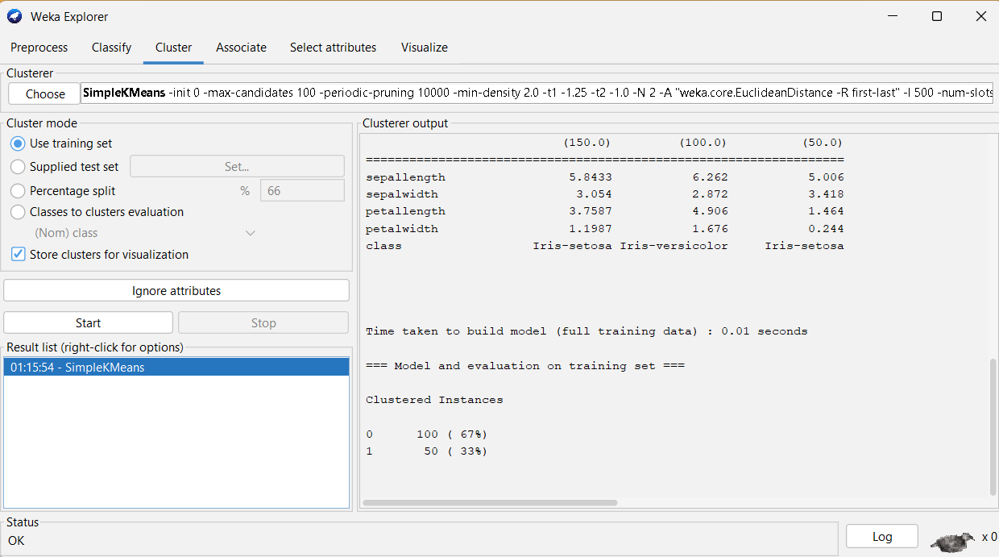
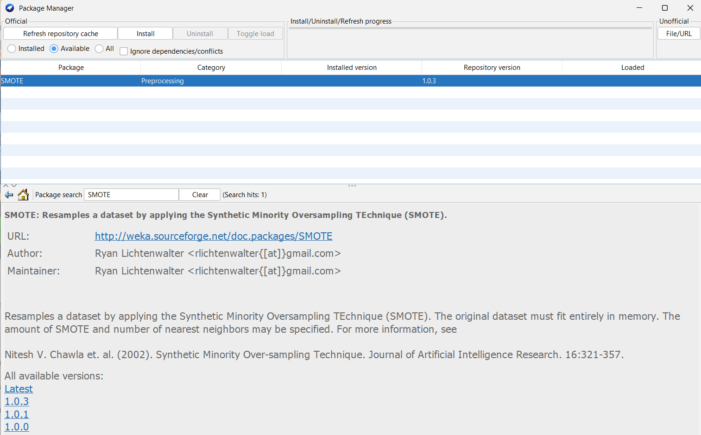
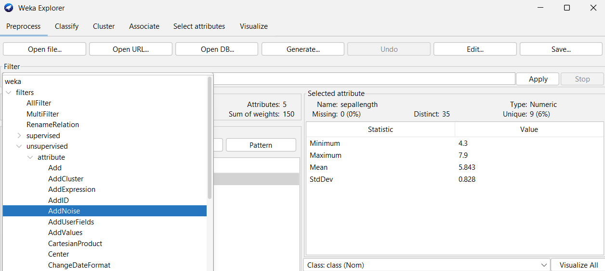

## Định dạng dữ liệu ARFF

ARFF (Attribute-Relation File Format) là định dạng tệp gốc của WEKA; WEKA cũng đọc được CSV và một số định dạng khác, nhưng ARFF đầy đủ thông tin nhất.

### Cấu trúc tệp ARFF

Một tệp ARFF có ba phần chính:

**Ba phần của tệp arff**

- Phần 1 - Tên quan hệ (Relation): khai báo tên tập dữ liệu, mở đầu bằng @relation
- Phần 2 - Khai báo thuộc tính (Attributes): các cột dữ liệu, mở đầu bằng @attribute; mỗi thuộc tính có tên và kiểu dữ liệu
- Phần 3 - Dữ liệu (Data): các mẫu thực tế sau dòng @data, mỗi dòng một mẫu, các giá trị cách nhau bởi dấu phẩy

### Ví dụ tệp ARFF đầy đủ

**Ví dụ: tập dữ liệu weather**

File weather.nominal.arff có sẵn trong thư mục data của WEKA:

```
@relation weather

@attribute outlook {sunny, overcast, rainy}
@attribute temperature {hot, mild, cool}
@attribute humidity {high, normal}
@attribute windy {TRUE, FALSE}
@attribute play {yes, no}

@data
sunny,hot,high,FALSE,no
sunny,hot,high,TRUE,no
overcast,hot,high,FALSE,yes
rainy,mild,high,FALSE,yes
rainy,cool,normal,FALSE,yes
rainy,cool,normal,TRUE,no
overcast,cool,normal,TRUE,yes
% Cac dong bat dau bang dau % la chu thich
```

### Các kiểu dữ liệu trong ARFF

*Bảng 1. Các kiểu dữ liệu ARFF*

| Kiểu | Cú pháp | Ví dụ |
|---|---|---|
| Numeric (số) | @attribute name numeric | @attribute age numeric |
| Nominal (phân loại) | @attribute name {v1, v2, v3} | @attribute color {red, blue, green} |
| String (chuỗi) | @attribute name string | @attribute comment string |
| Date (ngày) | @attribute name date 'yyyy-MM-dd' | @attribute dob date 'yyyy-MM-dd' |

**Giá trị thiếu**

Trong ARFF, giá trị thiếu được biểu diễn bằng dấu chấm hỏi “?”.

     Ví dụ:   sunny, ?, high, FALSE, yes

Dòng trên có giá trị temperature bị thiếu.

### Chuyển CSV sang ARFF

**Hai cách chuyển**

- Cách 1. WEKA tự đọc CSV - mở tệp CSV bằng “Open file” trong tab Preprocess, WEKA tự nhận diện kiểu dữ liệu và đọc trực tiếp; có thể lưu lại thành ARFF bằng “Save”
- Cách 2. Dùng công cụ chuyển đổi từ dòng lệnh:
```
java -cp weka.jar weka.core.converters.CSVLoader \
    input.csv > output.arff
```

> ⚠  Lưu ý khi chuyển CSV sang arff
> •   Tên cột trong header không được có dấu cách hoặc ký tự đặc biệt
> •  Kiểm tra kiểu dữ liệu sau khi chuyển vì WEKA có thể đoán nhầm (nominal thành numeric hoặc ngược lại)
> •   Giá trị thiếu trong CSV (ô trống, “NA”) cần chuyển thành “?”
> •   Nên dùng encoding UTF-8 để tránh lỗi với tiếng Việt

## WEKA Explorer

Explorer là ứng dụng chính được dùng trong giáo trình, gồm 6 tab; Mục này mô tả từng tab và các thành phần chính.

### Tab Preprocess

**Chức năng**

Tab Preprocess là tab đầu tiên và được dùng trong mọi bài thực hành. Tab này cho phép đọc dữ liệu bằng Open file (tệp trên máy), Open URL (tệp trên mạng) hoặc Open DB (cơ sở dữ liệu); xem thông tin tổng quan gồm số mẫu, số thuộc tính và kiểu của từng thuộc tính; áp dụng bộ lọc để chuẩn hóa, rời rạc hóa, xử lý giá trị thiếu hoặc lọc bỏ thuộc tính; và vẽ histogram của từng thuộc tính.

**Các thành phần chính của tab preprocess**

- Khu vực trên cùng: nút Open file, Open URL, Open DB, Generate, Undo, Edit, Save
- Khu Filter: nút Choose để chọn bộ lọc, Apply để áp dụng
- Khu Current relation: tên tập dữ liệu, số mẫu, số thuộc tính
- Khu Attributes (giữa): danh sách thuộc tính kèm checkbox để chọn
- Khu Selected attribute (phải): chi tiết thuộc tính được chọn (kiểu, số giá trị duy nhất, missing values, histogram)


* 1 1 2 2 3 3 4 4 5 5*

* Hình 1. Tab Preprocess với tập dữ liệu Iris*

### Tab Classify

**Chức năng**

Tab Classify dùng cho bài toán phân lớp (Chương 4 của giáo trình) và một số bài toán khác có nhãn:

Choose: chọn thuật toán (IBk tức KNN, J48, MultilayerPerceptron, NaiveBayes, RandomForest, v.v.).

- Test options: cách đánh giá (Use training set, Cross-validation, Percentage split, Supplied test set)
- More options: tùy chỉnh đầu ra (ROC curve, confusion matrix, classifier model)
- Start: chạy thuật toán
- Result list: các lần chạy (kích chuột phải để xem chi tiết, vẽ ROC, lưu mô hình)
- Classifier output: kết quả chi tiết

**Cách chạy một thuật toán phân lớp**

- Bước 1. Choose > chọn thuật toán (ví dụ trees > J48)
- Bước 2. Kích vào dòng cấu hình thuật toán để chỉnh tham số
- Bước 3. Chọn Test options (mặc định Cross-validation 10 folds)
- Bước 4. Chọn lớp mục tiêu trong dropdown dưới Test options (mặc định cột cuối)
- Bước 5. Nhấn Start, đợi vài giây đến vài phút
- Bước 6. Đọc kết quả trong Classifier output; xem ROC bằng kích chuột phải entry trong Result list > Visualize Threshold Curve


*
Hình 2. Tab Classify chạy J48 trên Iris*

### Tab Cluster

**Chức năng**

Tab Cluster dùng cho bài toán phân cụm, chủ đề của Chương 5 của giáo trình. Phần thực hành ở Mục 5.4 của giáo trình được viết bằng Python, nên tab này chỉ dùng để thử nhanh và đối chiếu:

Choose: chọn thuật toán (SimpleKMeans, EM, HierarchicalClusterer, v.v.; DBSCAN/OPTICS trong WEKA 3,8 cần cài package optics_dbScan qua Tools > Package Manager).

- Cluster mode: cách đánh giá kết quả
- Ignore attributes: bỏ qua thuộc tính không tham gia phân cụm
- Start: chạy thuật toán
- Cluster output: kết quả chi tiết các cụm


*Hình 3. Tab Cluster với SimpleKMeans*

### Tab Associate

**Chức năng**

Tab Associate dùng cho khai phá luật kết hợp (Chương 3 của giáo trình):

Choose: chọn thuật toán (Apriori, FPGrowth, FilteredAssociator, Tertius; trong khuôn khổ nhập môn chỉ cần làm quen với Apriori và FPGrowth);

- Khung tham số: hiển thị và cho phép chỉnh các tham số của thuật toán đang chọn, gồm ngưỡng Support, ngưỡng của chỉ số đã chọn và số luật cần xuất
- Start: chạy và sinh luật
- Associator output: các luật khai phá được kèm support, confidence, lift
- Khung Result list (phía dưới): lưu lịch sử các lần chạy; nhấn chuột phải vào một mục để xem lại hoặc lưu kết quả bằng Save result buffer
- Lưu ý: tab Associate yêu cầu dữ liệu nominal hoặc đã rời rạc hóa; dữ liệu số phải dùng FilteredAssociator hoặc rời rạc hóa trước

### Tab Select attributes

**Chức năng**

Tab Select attributes dùng để chọn các thuộc tính quan trọng nhất:

Attribute Evaluator: phương pháp đánh giá thuộc tính (InfoGainAttributeEval, CfsSubsetEval, ChiSquaredAttributeEval, v.v.);

Search Method: chiến lược tìm tập con (Ranker, BestFirst, GreedyStepwise, v.v.).

Kết quả là danh sách thuộc tính xếp hạng theo mức độ quan trọng, giúp lựa chọn đặc trưng (Mục 2.5.2 của giáo trình) trước khi xây dựng mô hình.

### Tab Visualize

**Chức năng**

Tab Visualize vẽ ma trận biểu đồ phân tán (scatter plot matrix) giữa các cặp thuộc tính; màu sắc biểu thị lớp (nếu có nhãn), kích vào một ô để xem chi tiết. Trực quan hóa giúp khám phá quan hệ giữa các thuộc tính và mức độ phân biệt giữa các lớp.

## Quy trình thực hành tổng quát

Khi dùng cross-validation để đánh giá phân lớp, đặt bộ lọc cần học tham số từ dữ liệu trong FilteredClassifier để fit riêng ở mỗi fold. Không chuẩn hóa, điền thiếu hoặc chọn đặc trưng trên toàn bộ dữ liệu rồi mới đánh giá CV.

Khi đối mặt với một bài toán mới trong WEKA, người học có thể tuân theo quy trình 5 bước sau:

**Quy trình 5 bước**

- Bước 1. Mở dữ liệu trong tab Preprocess (Open file, chọn tệp ARFF hoặc CSV); quan sát số mẫu, số thuộc tính, kiểu dữ liệu
- Bước 2. Khám phá và tiền xử lý: xem thống kê từng thuộc tính; nếu cần, áp dụng filter (chuẩn hóa, rời rạc hóa, xử lý giá trị thiếu)
- Bước 3. Chọn tab theo bài toán: phân lớp > Classify; phân cụm > Cluster; luật kết hợp > Associate
- Bước 4. Nhấn Choose chọn thuật toán phù hợp, kích vào dòng cấu hình để chỉnh tham số, đặt cách đánh giá (Cross-validation 10 folds là mặc định an toàn)
- Bước 5. Nhấn Start và đọc kết quả trong output; nếu cần, nhấp chuột phải vào mục kết quả trong Result list để xem biểu đồ, lưu mô hình, hoặc so sánh với lần chạy trước

**Vòng lặp cải thiện**

Hiếm khi mô hình đầu tiên là tốt nhất. Sau bước 5, quay lại: thử thuật toán khác hoặc tinh chỉnh tham số (bước 4), thay đổi tiền xử lý (bước 2), chọn lại đặc trưng (tab Select attributes). Mỗi lần chạy tạo một mục kết quả mới trong Result list, cho phép so sánh các phương án.

## Đọc kết quả output

Classifier output có cấu trúc cố định; cần biết đọc từng phần để hiểu hiệu năng mô hình.

### Các phần trong Classifier output

**Cấu trúc chuẩn của output**

- Phần 1 - Run information: các tham số đã dùng (thuật toán, tập dữ liệu, số mẫu, cách đánh giá)
- Phần 2 - Classifier model (full training set): mô tả mô hình đã học (cấu trúc cây, hệ số hồi quy, trọng số mạng nơ-ron)
- Phần 3 - Time taken: thời gian xây dựng và kiểm thử mô hình
- Phần 4 - Stratified cross-validation summary: Correctly/Incorrectly Classified Instances, Kappa statistic, Mean absolute error, v.v
- Phần 5 - Detailed Accuracy By Class: TP Rate, FP Rate, Precision, Recall, F1, MCC, ROC Area cho từng lớp và trung bình
- Phần 6 - Confusion Matrix: ma trận nhầm lẫn N x N

### Ví dụ đọc output J48 trên Iris

**Cách đọc kết quả**

```
=== Run information ===
Scheme:       weka.classifiers.trees.J48 -C 0.25 -M 2
Relation:     iris
Instances:    150
Attributes:   5
Test mode:    10-fold cross-validation

=== Classifier model (full training set) ===
J48 pruned tree
petalwidth <= 0.6: Iris-setosa (50.0)
petalwidth > 0.6
|   ...

=== Stratified cross-validation ===
Correctly Classified Instances     144   96 %
Incorrectly Classified Instances     6    4 %

=== Detailed Accuracy By Class ===
Class              TP    FP    Prec   Recall  F1     ROC
Iris-setosa       0.98  0.00  1.000  0.980   0.990  0.990
Iris-versicolor   0.94  0.03  0.940  0.940   0.940  0.952
Iris-virginica    0.96  0.03  0.941  0.960   0.950  0.961
Weighted Avg.     0.96  0.02  0.960  0.960   0.960  0.968

=== Confusion Matrix ===
  a   b   c   <-- classified as
 49   1   0 |  a = Iris-setosa
  0  47   3 |  b = Iris-versicolor
  0   2  48 |  c = Iris-virginica
```

**Cách đọc**

- Kiểm tra Test mode để biết kết quả từ đâu (cross-validation đáng tin hơn training set)
- Đọc Accuracy chung: 96% là rất tốt
- Đọc Detailed Accuracy By Class: Iris-setosa có Precision 1,000 nhưng TP Rate chỉ 0,980 nên vẫn còn một mẫu bị xếp sai; hai lớp kia nhầm lẫn nhiều hơn
- Đọc Confusion Matrix để biết nhầm lẫn ở đâu: Versicolor và Virginica nhầm lẫn qua lại 5 mẫu (3 + 2), một mẫu Setosa bị xếp vào Versicolor
- Đọc ROC Area để biết khả năng phân biệt của mô hình
- Ghi nhớ hai quy ước của WEKA: cột TP Rate chính là Recall nên hai cột này luôn có cùng giá trị, và Recall ở dòng Weighted Avg. luôn bằng Accuracy chung

## Các tập dữ liệu có sẵn trong WEKA

Thư mục data/ trong thư mục cài đặt WEKA chứa nhiều tập dữ liệu chuẩn, kinh điển trong cộng đồng máy học và được dùng nhiều trong giáo trình.

*Bảng 2. Các tập dữ liệu thường dùng trong WEKA*

| Dataset | Mục đích | Mẫu | Đặc trưng | Lớp |
|---|---|---|---|---|
| iris.arff | Phân lớp hoa Iris | 150 | 4 | 3 |
| weather.nominal.arff | Dự đoán có chơi tennis | 14 | 4 | 2 |
| weather.numeric.arff | Như trên, dạng số | 14 | 4 | 2 |
| supermarket.arff | Luật kết hợp siêu thị | 4627 | 217 | - |
| breast-cancer.arff | Tái phát ung thư vú | 286 | 9 | 2 |
| diabetes.arff | Bệnh tiểu đường | 768 | 8 | 2 |
| segment-test.arff | Phân lớp ảnh phân đoạn | 810 | 19 | 7 |
| vote.arff | Bỏ phiếu Quốc hội Mỹ | 435 | 16 | 2 |
| glass.arff | Phân loại kính | 214 | 9 | 7 |
| soybean.arff | Chẩn đoán bệnh đậu nành | 683 | 35 | 19 |

**Vị trí thư mục data**

Vị trí thư mục data theo hệ điều hành - Windows: C:\Program Files\Weka-3-8\data\; macOS: /Applications/weka-3-8/data/; Linux: thư mục giải nén/data/.

Nút “Open file” trong Explorer mặc định mở đến thư mục này (tên thư mục có thể thay đổi tùy theo phiên bản Weka cài đặt)

## Bộ lọc (Filters)

Bộ lọc là các phép tiền xử lý áp dụng trong tab Preprocess, chia hai loại: supervised (cần nhãn) và unsupervised (không cần nhãn).

### Các filters thường dùng

*Bảng 3. Các filters quan trọng trong WEKA*

| Filter | Đường dẫn | Chức năng |
|---|---|---|
| Normalize | unsupervised > attribute | Chuẩn hóa các thuộc tính số về [0, 1] |
| Standardize | unsupervised > attribute | Chuẩn hóa zero-mean, unit-variance |
| Discretize | unsupervised > attribute | Rời rạc hóa thuộc tính số |
| ReplaceMissingValues | unsupervised > attribute | Điền giá trị thiếu (trung bình/mode) |
| Remove | unsupervised > attribute | Loại bỏ các thuộc tính theo chỉ số |
| NominalToBinary | unsupervised > attribute | Chuyển nominal thành binary |
| SMOTE | supervised > instance | Cân bằng dữ liệu mất cân bằng (cần cài package SMOTE qua Tools > Package Manager) |
| Resample | supervised > instance | Lấy mẫu lại với tỷ lệ tùy chỉnh |
| AttributeSelection | supervised > attribute | Chọn thuộc tính quan trọng |



*Hình 4. Package Manager cài SMOTE*

### Cách áp dụng filter

**Các bước**

- Bước 1. Đọc tập dữ liệu trong tab Preprocess (Open file)
- Bước 2. Trong khu vực Filter, nhấn Choose
- Bước 3. Duyệt cây thư mục (filters > unsupervised > attribute > Normalize)
- Bước 4. Kích vào dòng filter để chỉnh tham số (nếu cần)
- Bước 5. Nhấn Apply - tập dữ liệu được biến đổi tại chỗ
- Bước 6. Quan sát kết quả ở Selected attribute và Visualize


*Hình 5. Hộp thoại chọn Filter*

**Chú ý khi áp dụng filters**

- Thứ tự áp dụng các bộ lọc ảnh hưởng đến kết quả: áp dụng Normalize trước rồi Discretize cho kết quả khác với thứ tự ngược lại
- Mỗi lần Apply tập dữ liệu bị thay đổi; nhấn Undo để khôi phục
- FilteredClassifier trong tab Classify chỉ áp dụng filter trong quá trình huấn luyện/kiểm tra, tránh data leakage
- Lưu tập dữ liệu đã xử lý bằng Save trước khi đóng để không phải làm lại

## Tự động hóa qua Command Line

WEKA còn chạy được từ dòng lệnh, hữu ích khi cần tự động hóa, chạy hàng loạt thí nghiệm, hoặc tích hợp vào script lớn hơn.

### Cú pháp chung

```
java -cp weka.jar weka.classifiers.<thuat_toan> \
    -t <file_dataset.arff> \
    [cac tham so khac]
```

### Ví dụ chạy J48 trên Iris

```
java -cp weka.jar weka.classifiers.trees.J48 \
    -t data/iris.arff \
    -x 10
```

**Giải thích tham số**

-cp weka.jar: chỉ định classpath, dùng weka.jar.

weka.classifiers.trees.J48: tên đầy đủ của thuật toán.

-t data/iris.arff: tập dữ liệu huấn luyện (training). -x 10: dùng 10-fold cross-validation.

Kết quả in ra terminal, giống output trong GUI nhưng không có biểu đồ.

### Các tham số thông dụng

*Bảng 4. Tham số command line phổ biến*

| Tham số | Ý nghĩa |
|---|---|
| -t <file> | File huấn luyện |
| -T <file> | File kiểm tra riêng |
| -x <K> | K-fold cross-validation |
| -c <N> | Cột nhãn (mặc định cột cuối) |
| -d <file> | Lưu mô hình ra tệp |
| -l <file> | Nạp mô hình từ tệp |
| -p <N> | In dự đoán cho từng mẫu |

**Chạy hàng loạt bằng script**

Có thể viết script bash để chạy nhiều thuật toán trên cùng tập dữ liệu:

```
#!/bin/bash
for algo in trees.J48 lazy.IBk bayes.NaiveBayes trees.RandomForest; do
    echo "--- $algo ---"
    java -cp weka.jar weka.classifiers.${algo} \
         -t data/iris.arff -x 10
done
```

## Lỗi thường gặp và cách khắc phục

**Lỗi 1: OutOfMemoryError**

Hiện tượng: WEKA báo “OutOfMemoryError: Java heap space” khi mở tập dữ liệu lớn hoặc chạy thuật toán phức tạp. Cách khắc phục: tăng bộ nhớ cấp cho WEKA.

Trên Windows, sửa tệp RunWeka.ini trong thư mục cài đặt: maxheap=2048m → 4096m hoặc 8192m.

Trên Mac/Linux, chạy từ dòng lệnh với tham số -Xmx:

```
java -Xmx4096m -jar weka.jar
```

**Lỗi 2: không chạy được thuật toán**

- Hiện tượng: “Cannot handle numeric attributes” hoặc tương tự
Nguyên nhân: thuật toán không phù hợp với kiểu dữ liệu. Ví dụ Apriori chỉ hỗ trợ thuộc tính định danh (nominal)

- Cách khắc phục: áp dụng filter Discretize hoặc NumericToNominal trước

**Lỗi 3: không xử lý được giá trị thiếu**

Hiện tượng: thuật toán không chạy được vì có giá trị thiếu. Cách khắc phục: áp dụng filter ReplaceMissingValues trước khi chạy thuật toán.

**Lỗi 4: kết quả không tái lập**

Hiện tượng: chạy 2 lần cùng cấu hình cho ra kết quả khác nhau, do thuật toán có thành phần ngẫu nhiên (Random Forest, MultilayerPerceptron, SMOTE). Cách khắc phục: trong cấu hình thuật toán, đặt tham số seed một giá trị cố định (ví dụ 42).

**Lỗi 5: CSV không đọc được**

Hiện tượng: tệp CSV không mở được hoặc đọc sai cột. Cách khắc phục: kiểm tra encoding (nên dùng UTF-8); kiểm tra dấu phân cách (mặc định dấu phẩy, nếu là tab hoặc chấm phẩy phải đổi); loại bỏ ký tự đặc biệt trong tên cột; lưu CSV bằng Notepad++ hoặc VS Code thay vì Excel để tránh BOM.

**Lỗi 6: tệp lưu mô hình quá lớn**

Hiện tượng: lưu Random Forest với 500 cây ra tệp rất lớn; kích thước tệp tăng theo số cây và theo kích thước tập dữ liệu huấn luyện. Cách khắc phục: giảm số cây hoặc dùng thuật toán nhẹ hơn (J48, Logistic).

**Lỗi 7: WEKA bị treo (hang) khi chạy**

Hiện tượng: nhấn Start nhưng WEKA không phản hồi. Nếu thuật toán vẫn đang chạy (ví dụ MultilayerPerceptron với nhiều epoch) thì đây là hiện tượng bình thường: mở Task Manager trên Windows hoặc Activity Monitor trên macOS để xem tiến trình có dùng CPU hay không. Nếu tiến trình không dùng CPU trong thời gian dài, nhiều khả năng đã xảy ra deadlock; hãy đóng WEKA rồi mở lại.

## Tài nguyên học sâu hơn

**Tài liệu chính thức**

- WEKA Wiki: https://waikato.github.io/weka-wiki/ - tài liệu đầy đủ về mọi chức năng.
- WEKA Manual: https://sourceforge.net/projects/weka/files/documentation/

**Khóa học online miễn phí**

“Data Mining with Weka” - Ian Witten (University of Waikato). Khóa MOOC miễn phí trên FutureLearn, do chính tác giả WEKA giảng dạy.

Link: https://www.futurelearn.com/courses/data-mining-with-weka

**Sách kinh điển**

Witten, I. H., Frank, E., Hall, M. A., & Pal, C. J. (2016). Data Mining: Practical Machine Learning Tools and Techniques (4th ed.). Morgan Kaufmann. Sách giáo khoa đi kèm WEKA, do chính nhóm phát triển viết.

**Cộng đồng và hỗ trợ**

- WEKA Mailing List: https://list.waikato.ac.nz/mailman/listinfo/wekalist
- Stack Overflow: tag “weka”. Research Gate: nhiều nghiên cứu so sánh WEKA với các công cụ khác.

**Bài tập thực hành**

- Bài 1: Khám phá tập dữ liệu Glass Mở glass.arff trong WEKA, áp dụng quy trình 5 bước (mục Quy trình thực hành tổng quát): Quan sát số mẫu, số thuộc tính, các lớp. Chạy J48 với 10-fold CV. Ghi lại Accuracy. Chạy thêm Naive Bayes, KNN, Random Forest. So sánh. Tạo bảng so sánh 4 thuật toán
- Bài 2: So sánh trước và sau chuẩn hóa Trên tập dữ liệu Diabetes: Chạy KNN (k=5) trên dữ liệu gốc, ghi Accuracy. Áp dụng filter Normalize, chạy lại KNN, ghi Accuracy. Áp dụng filter Standardize, chạy lại, ghi Accuracy. Nhận xét về tác động của chuẩn hóa đến KNN
- Bài 3: Tự chuyển dữ liệu CSV sang ARFF Tải một tập dữ liệu CSV bất kỳ từ UCI Repository, chuyển sang ARFF, mở trong WEKA. Mô tả các bước đã làm và vấn đề gặp phải nếu có
